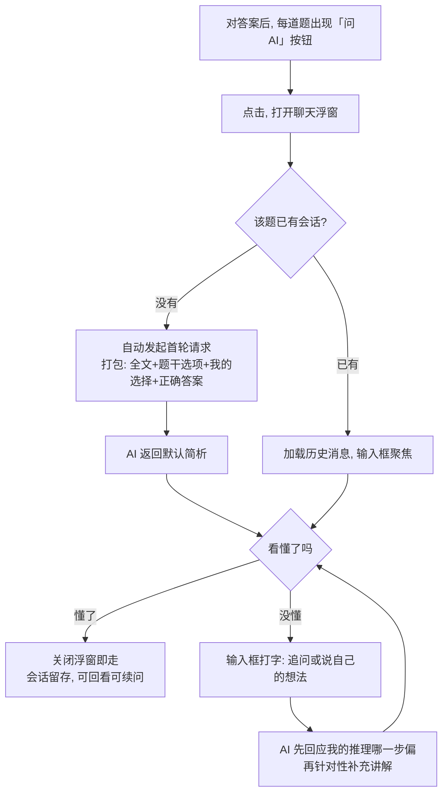

# 交接-主仓-阅读题当场问AI

状态：**方案草案，待作者拍板后交代码智能体执行**。2026-11-04。
本文档只定「做什么、怎么交互、验收什么」，不含任何已执行的开发内容。

## 一、需求与场景

用户（LiZF 本人，CET-4 备考中）做阅读题对答案时，经常遇到"选错了但不知道为什么错"的情况。现有功能止步于显示正确答案（答案键、reveal），从"知道答案"到"理解为什么"之间存在空白，目前的出路是切到外部 DeepSeek 聊天窗，手动复制题目和原文，用完即弃，追问的上下文也不在站内留存。

本功能补上这段空白：每道题旁给一个「问 AI」入口，点开先自动给一份简短解析，看懂就关，看不懂就继续追问，可以把自己的想法说出来让 AI 判断推理哪一步走偏，直到理解为止。

对应资产库定位文档中「掌握错觉」问题：以为理解了和真正理解之间的差距，靠当场追问当场消除。

## 二、交互流程

要点：

1. **首轮零门槛**。点开浮窗不需要用户先打字，系统自动发起首轮请求，用户坐等简析即可。首轮请求的内容由前端自动携带，用户无从感知打包细节。
2. **首轮简析有固定骨架**（见第三节），保证最常见场景（看一眼简析就走）每次都拿到结构一致、信息密度高的解析，而不是泛泛而谈。
3. **追问是自由对话**。用户可以问细节（"第二段那句话到底什么意思"），也可以表达想法（"我觉得 B 也说得通，因为……"）。后一种是本功能的核心价值，AI 必须先诊断用户推理链哪一步走偏，再补充讲解，而不是把简析换种说法重复一遍。
4. **随时可走**。关窗即结束，没有确认步骤。会话按题保存，下次点开同一题的按钮，历史消息原样加载，可继续追问。
5. **按钮全员可见**。做对的题也能问——蒙对但没把握、做对但想知道别的选项为什么不选，同样是真实场景。[假设—待确认，见第七节]

## 三、AI 输出规格

### 首轮默认简析

打包给模型的上下文：文章全文、该题题干与全部选项、用户的作答选择、正确答案。若用户答对，简析侧重"为什么对"；若答错，侧重"错在哪"。

简析按固定骨架输出，控制在一段到三段短文，总长不超过两百字：

- **定位**：正确答案的依据在原文哪一句，原样引用该句；
- **排除**：错误选项（含用户错选的那个）分别踩了什么坑，一句话点到（张冠李戴、过度推断、偷换范围等）；
- **收束**：一句话总结本题考什么。

### 追问轮

- 每轮把该题完整会话历史一并发给模型，全文已在首轮消息里，后续轮不重复打包全文；
- 模型行为要求（写入 system/首条指令）：用户表达自己的想法时，先指出其推理从哪一步开始偏离原文，再讲解；只重复简析内容而不回应用户推理的回复视为不合格输出；
- 语气要求：直接、具体，引用原文原句作证，不输出"加油""你可以的"之类鼓励性废话；
- 调用参数与查词代理一致：`chat_completion`，自由文本不启用 json_mode，温度 0.3，关闭思考保证秒级返回（若实测解析质量欠佳，去掉关思考参数属内容层调参，一次改一行）。

## 四、数据与改动落点

| 层 | 文件 | 内容 |
|---|---|---|
| 数据层 | `lykie/readings.py` | `readings.json` 的 text 条目下按题号挂 `ask_ai` 线程数组，每条消息 `{role, content, time}`；提供读取与追加函数，单题上限保留最近 20 条，超出丢最旧 |
| 接口层 | `app.py` | 两条路由：`GET /api/reading/<text_id>/ask/<num>`（取该题会话历史）、`POST /api/reading/<text_id>/ask/<num>`（发消息，body 可为空表示请求首轮简析；无答案键时返回明确错误） |
| 前端 | `static/reading.js`、`reading.css` | 对答案后每题注入「问AI」按钮；聊天浮窗组件（消息列表 + 输入框 + 发送）；静态资源 bump 版本 |

复用项：LLM 管道复用 `lykie_llm.chat_completion`（查词代理已验证）；浮窗拖拽复用现有悬浮框实现；readings.json 原子写入管道现成。

## 五、前端形态

- 桌面：可拖拽浮窗，位置记忆不持久化（每次打开居中偏右即可），大小固定，宽度约 420px，高度不超过视口八成，内部消息区滚动；
- 手机：先不做，桌面验证跑通后再补底部抽屉式面板。[假设—待确认，见第七节]
- 发送中输入框与按钮置灰防重复提交；AI 回复前显示占位"正在解析…"；
- 打开浮窗即自动 POST 首轮（仅当该题无历史时），用户无需任何输入。

## 六、边界与明确不做

- **不接入 Lykie 聊天面板**：人设对话与学习解析是两条通道，混用会互相污染体验；
- **不做流式输出**：现有管道全部非流式，简析百来字等待可接受；
- **不自动联动资产库**：对话中聊到的生词仍走既有划词查词录入，各走各的；
- **无答案键时不可用**：按钮置灰，点击提示"请先生成或导入答案"（选词填空已 reveal 的题视为有答案）；
- **纯文章无题目**：不提供问 AI 入口（本功能绑定题号，没有题号就没有会话锚点）；
- 模型调用失败（Key 失效、断网）：浮窗内显示错误信息与"重试"按钮，不阻塞已保存的历史消息；
- 成本：BYOK 烧用户自己的 Key，仔细阅读单轮打包约 600–1000 token，单题完整追问一轮大约 2000–4000 token。

## 七、更好的方法与待拍板项

写作本文档时已把三条改进建议直接吸收进主方案（按钮全员可见、首轮固定骨架带原文定位句、追问先诊断推理再讲解），不再单列。以下两件事供作者判断：

1. **追问记录是"残余缺口"的原始证据（远期方向，本次不做）**。问 AI 的对话天然记录了"我以为我懂其实没懂"的具体位置。将来资产库做残余缺口显影时，这批会话是现成的数据源。本次只需保证数据结构干净（按题号归属、不丢不混），不需要任何额外开发。
2. **会话是否跟随 reset 清除**：阅读视图的 reset 会清作答。会话跟着清可以理解，不跟着清则保留回看价值。推荐不跟随（会话与作答解耦，重做一遍题后历史解析仍有参考价值）。

待拍板三项（已在方案中按推荐默认写好，拍板即定稿，不拍板则维持默认）：

| # | 事项 | 方案默认 | 备选 |
|---|---|---|---|
| 1 | 按钮是否对做对的题也显示 | 全员显示 | 仅错题显示 |
| 2 | 会话是否持久化 | 持久化，可回看可续问 | 关窗即弃 |
| 3 | 手机端 | 本次只做桌面 | 同步做手机抽屉 |

## 八、验收标准

1. 对答案后每题出现按钮；点开自动出首轮简析，简析含原文定位句引用、错项分析、一句话总结三要素；
2. 追问"我觉得 B 对，因为……"时，回复中出现对用户推理的具体回应，而非简析复读；
3. 关窗再开，历史完整加载，可继续追问；单题消息超 20 条时最旧的被丢弃，会话不损坏；
4. 无答案键的题按钮不可用且有提示；有答案键但用户未作答的题，简析正常输出（无"你的选择"字段时模型按纯解析处理）；
5. 拔 Key 模拟调用失败：浮窗显示错误与重试按钮，重试成功后恢复正常，历史消息无污染；
6. 模型调用测试全程 monkeypatch，不烧真实 Key，`data/` 零污染；
7. 桌面浮窗可拖拽、发送中防重复、消息区超长滚动正常。

## 服务器

无额外部署操作，随常规 `git push server main` 生效。

2026-11-04
